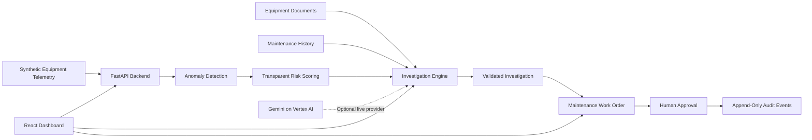

# PlantGuard AI
### Predict problems. Explain risks. Prevent avoidable downtime.

**An AI-powered industrial operations copilot for predictive maintenance, evidence-based fault investigation, and safer factory operations.**

**Team:** Hacknetic Force  
**Competition:** Google Cloud AI Builder Cup 2026  
**Track:** Manufacturing: Intelligent Operations & Industrial Efficiency

---

## Overview

Industrial teams often rely on fragmented sensor readings, maintenance logs, and equipment documentation to identify machine problems. This makes early fault investigation difficult and can delay maintenance decisions.

**PlantGuard AI** connects equipment telemetry, anomaly detection, transparent risk assessment, maintenance knowledge, and generative AI in a single operational workflow.

The platform detects unusual machine behavior, investigates available evidence, generates explainable maintenance recommendations, and creates work orders that require human approval. Important workflow transitions are recorded in an audit trail.

The objective is to help maintenance teams identify potential issues earlier, investigate them more efficiently, and make better-informed operational decisions.

> PlantGuard AI is a hackathon prototype. Its deterministic synthetic telemetry supports repeatable demonstrations and does not establish real-world failure prediction accuracy or proven downtime savings.

## Key Features

- **Industrial operations dashboard:** Asset health, alert queues, risk distribution, operational trends, and maintenance activity derived from backend data.
- **Asset intelligence:** Searchable equipment registry, sensor history, anomaly timelines, and maintenance records.
- **Anomaly detection:** Statistical detection of unusual vibration, temperature, pressure, and sensor-data conditions.
- **Transparent risk scoring:** A documented 0–100 heuristic score with contributing factors and uncertainty warnings. It is not a calibrated probability of failure.
- **AI investigation copilot:** Gemini on Vertex AI, when configured, generates structured investigations grounded in available telemetry, maintenance history, and retrieved documents.
- **Evidence-based fallback:** A deterministic investigation engine supports local demonstrations when cloud credentials are unavailable.
- **Maintenance knowledge retrieval:** Local PDF and text ingestion with keyword-based retrieval and source references.
- **Human-approved work orders:** Create, approve, reject, start, and complete maintenance work orders with persistent status and completion notes.
- **Audit trail:** Records important work-order and approval events.
- **Guided demonstration:** A repeatable motor-fault scenario for asset `MTR-204`, in which vibration rises before temperature escalates.
- **Local persistence:** SQLite stores application state for development and demonstration.

## How It Works

1. **Monitor:** Collect synthetic equipment telemetry and asset metadata.
2. **Detect:** Compare sensor observations against established baselines and identify anomalies.
3. **Assess:** Calculate a transparent risk score based on observed conditions.
4. **Investigate:** Retrieve relevant maintenance evidence and generate structured findings.
5. **Recommend:** Propose diagnostic checks and maintenance actions while identifying uncertainty.
6. **Approve:** Allow a human reviewer to approve or reject a proposed work order.
7. **Audit:** Record the decision and subsequent work-order status changes.

## Architecture



### Technology Stack

| Layer | Technologies |
|---|---|
| Frontend | React, TypeScript, Vite, Tailwind CSS, Recharts |
| Backend | Python, FastAPI, Pydantic |
| Persistence | SQLite, SQLAlchemy |
| AI | Gemini through the Google Gen AI SDK with Vertex AI configuration |
| Detection | Statistical anomaly detection and transparent heuristic risk scoring |
| Document retrieval | Local PDF/text ingestion and keyword-based retrieval |
| Cloud deployment target | Google Cloud Run |
| Potential cloud extensions | BigQuery, Cloud Storage, Pub/Sub |

Optional Google Cloud integrations must be configured before they can be considered active. The local prototype is designed to run without cloud credentials.

## Quick Start

### Prerequisites

- Python 3.11 or a compatible version supported by the backend dependencies
- Node.js and npm
- Git

### Option 1: Start the complete local application

From the repository root:

```bash
npm install
npm run dev
```

The root development script is intended to start both the backend and frontend and open the browser automatically.

- **Frontend:** http://127.0.0.1:5173
- **Backend:** http://127.0.0.1:8000
- **API documentation:** http://127.0.0.1:8000/docs

The root `package.json` must contain the corresponding scripts and dependencies. If the combined startup command is not configured in your checkout, use the manual setup below.

### Option 2: Start the backend and frontend separately

**Backend**

From the repository root:

```bash
python -m pip install -r backend/requirements.txt
python -m uvicorn backend.app.main:app --reload --port 8000
```

**Frontend**

In a separate terminal:

```bash
cd frontend
npm install
npm run dev
```

Open http://127.0.0.1:5173.

Use the Python virtual environment recommended for your operating system. Confirm the import path and dependency instructions against the current repository if its structure differs.

## Configuration

Create a local `.env` file from the project's `.env.example`, if provided.

Local demonstration mode should work without Google Cloud credentials.

### Optional: Configure Gemini on Vertex AI

Install and configure the Google Cloud CLI, authenticate using Application Default Credentials, and select your project:

```bash
gcloud auth application-default login
gcloud config set project YOUR_PROJECT_ID
```

Enable the Vertex AI API:

```bash
gcloud services enable aiplatform.googleapis.com
```

Configure the backend environment:

```dotenv
USE_GEMINI=true
GOOGLE_CLOUD_PROJECT=YOUR_PROJECT_ID
GOOGLE_CLOUD_LOCATION=us-central1
GEMINI_MODEL=gemini-2.5-flash
```

Use a model available to your project and supported by the configured SDK and region. Ensure that the authenticated identity has the necessary permissions and that billing is configured where required.

Restart the backend after changing environment variables.

**Important:** The example configuration does not itself activate the live AI integration. Verify successful model invocation in the application logs and confirm that the response identifies the configured provider.

Never commit real credentials, API keys, or service-account files to the repository.

## Testing and Build

Run the project's configured test and build commands from the repository root:

```bash
npm run test
npm run build
```

These commands depend on the scripts defined in the current root `package.json`.

### Previously reported verification

The project notes report the following results from an earlier run:

- **Backend tests:** 11 passed.
- **Frontend production build:** Passed.
- **Build warning:** Vite reported a large JavaScript chunk associated with the Recharts-heavy dashboard bundle.

These are previously reported results, not a claim that the current checkout has just been re-tested. Rerun the commands above after any code changes.

### Recommended release checks

Before submission, verify the complete workflow:

- [ ] Frontend and backend start successfully.
- [ ] Dashboard metrics reflect backend data.
- [ ] Normal and anomalous telemetry produce appropriate detection results.
- [ ] Investigation findings reference real stored evidence.
- [ ] Live Gemini and fallback responses are distinguished accurately.
- [ ] Work orders can be approved, rejected, and completed.
- [ ] State persists after refreshing the browser.
- [ ] Audit events are recorded correctly.
- [ ] Simulator reset restores a repeatable initial state.
- [ ] Production build and automated tests pass.

## Google Cloud Deployment

Google Cloud Run is the intended backend deployment target.

Before deployment, confirm that:

1. The backend Dockerfile and build context are correct.
2. The application listens on the port provided by the Cloud Run environment.
3. Required environment variables and IAM permissions are configured.
4. The frontend points to the deployed backend endpoint.
5. Production CORS settings permit only the intended origins.
6. Persistent application data is stored in a suitable managed database or storage service.

Example deployment command, assuming the Dockerfile, build context, and runtime configuration have been verified:

```bash
gcloud run deploy plantguard-ai-api \
  --source ./backend \
  --region us-central1 \
  --set-env-vars USE_GEMINI=true,GOOGLE_CLOUD_PROJECT=YOUR_PROJECT_ID,GOOGLE_CLOUD_LOCATION=us-central1
```

Configure unauthenticated access only if the application is intentionally public and its security controls are appropriate. Otherwise, configure authentication and restrict access.

This command is an example, not a verified deployment procedure for every repository layout. Adapt it to the actual build configuration, frontend hosting arrangement, and environment variables.

**Deployment status:** The project notes indicate that a Cloud Run deployment has not yet been executed. No hosted deployment should be considered available until it has been successfully deployed and tested.

### Production considerations

- Cloud Run instances should not rely on local SQLite files for durable shared persistence.
- Use Cloud SQL or another appropriate managed database for persistent multi-instance operation.
- Use Cloud Storage for document objects where appropriate.
- Apply least-privilege IAM permissions.
- Add authentication and authorization before exposing sensitive operational data.
- Keep audit records durable and protect them from unauthorized modification.
- Do not connect the prototype to physical machinery without appropriate industrial safety engineering and authorization.

## Limitations

- Telemetry is synthetic and intended for demonstration and repeatable testing.
- The risk score is heuristic and is not a calibrated failure probability.
- Model performance has not been established on a representative, labeled industrial dataset.
- Local document retrieval uses keyword-based matching; production-grade semantic retrieval is a potential extension.
- SQLite is suitable for local demonstration, not as the default durable production database.
- Google Cloud services require configuration and verification before they can be described as operational integrations.
- Maintenance recommendations remain advisory and require human approval.

## Roadmap

1. Evaluate anomaly detection using larger, labeled industrial datasets.
2. Add calibrated predictive models where appropriate training data exists.
3. Introduce Pub/Sub for streaming telemetry ingestion.
4. Add BigQuery for historical operational analytics.
5. Integrate managed document storage and more advanced retrieval.
6. Introduce authenticated roles for technicians, engineers, and plant managers.
7. Add durable production storage and exportable audit reports.
8. Evaluate the system using clearly documented operational and technical metrics.

## Team

**Hacknetic Force**

Building practical AI systems for industrial intelligence, safer operations, and measurable real-world impact.

---

*PlantGuard AI is an independent hackathon prototype developed for the Google Cloud AI Builder Cup 2026. Any Google Cloud service integrations, performance results, and deployment claims should reflect the implementation actually verified in the repository.*