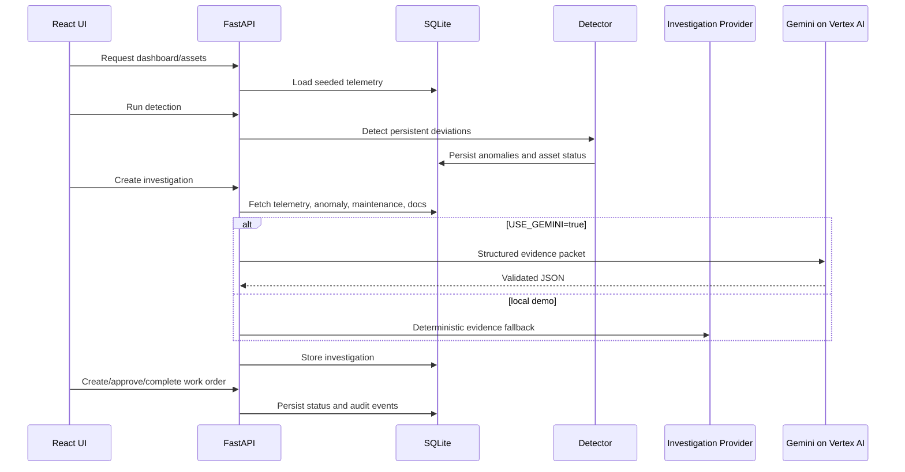

# Architecture

PlantGuard AI uses a local-first architecture so judges can run the complete workflow without paid APIs, while preserving a clean path to Google Cloud.

Core modules:

- `backend/app/seed.py`: deterministic industrial asset data and equipment knowledge.
- `backend/app/detector.py`: anomaly windows and risk scoring.
- `backend/app/ai.py`: provider interface, Gemini provider, and local fallback.
- `backend/app/retrieval.py`: upload validation, text extraction, chunking, and retrieval.
- `backend/app/main.py`: typed FastAPI endpoints.
- `frontend/src/main.tsx`: React operations console.
